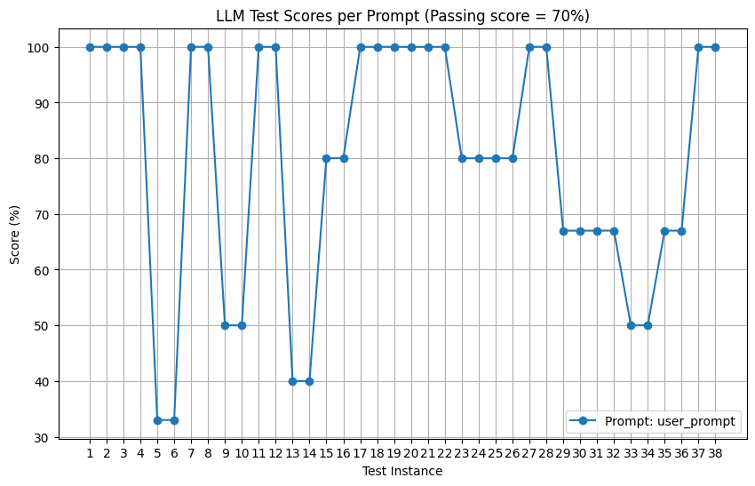
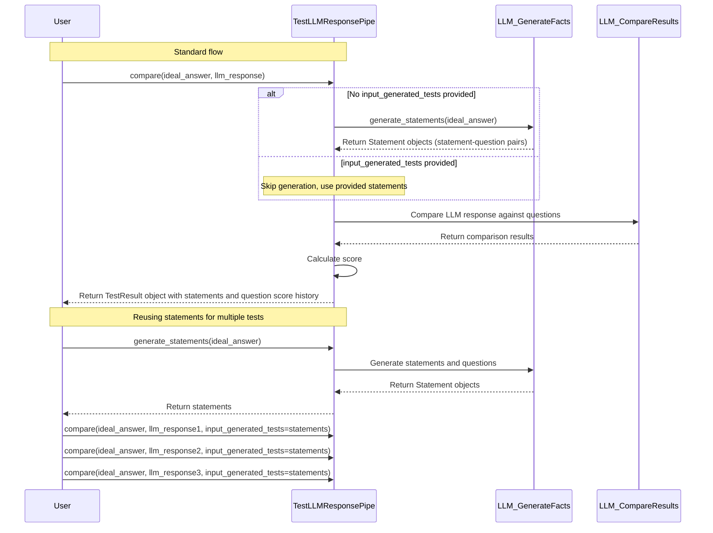

# Lamoom-CICD: Your AI Quality Assurance Engineer 🚀  
**Ensure Perfect LLM Responses - Before Your Users Notice Mistakes**

Tired of guessing if your AI's answers hit the mark? Lamoom-CICD acts as your 24/7 quality assurance team, automatically validating LLM responses against your standards. Get instant feedback and historical trends to continuously improve your prompts.

## Why Developers Love Us 💡

✔ **Precision Testing** - AI-generated evaluation questions catch nuances human reviewers might miss  
✔ **Historical Tracking** - Watch your prompt improvements materialize in real charts  
✔ **CI/CD Ready** - Batch test multiple scenarios in one CSV file  
✔ **Zero Configuration** - Get started with 3 lines of code  

## Get Started in 60 Seconds 🚦

```python
from lamoom_cicd import TestLLMResponsePipe

# 1. Define your gold standard and get LLM Response from your system
ideal_answer = "Blockchain: A shared digital ledger that's transparent and immutable"
get_llm_response = lambda: "Blockchain is like a public Google Doc that nobody can edit secretly"

# 2. Test your LLM's response
lamoom = TestLLMResponsePipe(openai_key="sk-your-key-here")
test_result = lamoom.compare(
    ideal_answer, 
    get_llm_response()
)

# 3. See instant quality report
print(f"Your AI scored {test_result.score}% ✅")
```

### Step 3: Understand Performance Trends
```python
# Basic visualization
lamoom.visualize_test_results()

# Advanced visualizations by grouping
# Group by ideal_answer (test questions)
lamoom.visualize_test_results(group_by="ideal_answer")

# Group by prompt_id from optional_params
lamoom.visualize_test_results(group_by="optional_param__prompt_id")

# Group by any field in optional_params
lamoom.visualize_test_results(group_by="optional_param__prompt_version")

# Multi-dimensional visualization (different lines for different models)
lamoom.visualize_test_results(
    group_by="optional_param__prompt_version",  # X-axis groups
    group_line_by="optional_param__model_name"  # Separate lines
)

# Add statistics (mean lines)
lamoom.visualize_test_results(show_statistics=True)

# Statistical visualizations
# Bar chart with means and standard deviations
lamoom.visualize_statistics(visualization_type="bar")

# Box plots to see score distributions
lamoom.visualize_statistics(visualization_type="box")

# Violin plots for detailed distribution view
lamoom.visualize_statistics(visualization_type="violin")

# Save visualizations for reports/documentation
lamoom.visualize_test_results(save_path="prompt_performance.png")
```


## Enterprise-Grade Testing Made Simple 🏗

### Batch Test Multiple Scenarios
`tests.csv`
```csv
ideal_answer,llm_response,optional_params
"Blockchain is...", "Your LLM response", "{""prompt_id"": ""onboarding_flow""}"
"Smart contracts...", "LLM answer here", "{""prompt_id"": ""dev_docs""}"
```

```python
results = lamoom.compare_from_csv("tests.csv")  # Perfect for CI/CD pipelines
```

### Deep Dive into Results
```python
latest_test = results[-1]

print(f"Overall score: {latest_test.score}%")
for q in latest_test.questions:
    print(f"Q: {q.question}")
    print(f"Expected: {q.expected_answer}") 
    print(f"Got: {q.actual_answer}")
    print(f"Match: {'✅' if q.is_match else '❌'}")
```

### Generate Statements Only
If you just want to generate statement-question pairs without running a full comparison:

```python
lamoom = TestLLMResponsePipe(openai_key="your-key-here")
statements = lamoom.generate_statements("Blockchain is a secure, immutable digital ledger.")

for statement in statements:
    print(f"Statement: {statement.statement}")
    print(f"Question: {statement.question}")
    print("---")
```

### Reuse Generated Tests
For efficiency, you can generate test questions once and reuse them for multiple LLM responses:

```python
lamoom = TestLLMResponsePipe(openai_key="your-key-here")

# Generate statements once
ideal_answer = "Blockchain is a secure, immutable digital ledger."
statements = lamoom.generate_statements(ideal_answer)

# Test multiple LLM responses using the same test questions
llm_responses = [
    "Blockchain works like a public, tamper-proof database.",
    "A blockchain is a distributed ledger that cannot be modified.",
    "Blockchain technology creates permanent records visible to all participants."
]

results = []
for response in llm_responses:
    # Pass pre-generated statements to avoid regenerating them
    result = lamoom.compare(
        ideal_answer=ideal_answer,
        llm_response=response,
        input_generated_tests=statements
    )
    results.append(result)

# Each result includes the full statement-question pairs
for i, result in enumerate(results):
    print(f"Response {i+1} Score: {result.score.score}%")
    
    # Access statement-question pairs
    for statement in result.statements:
        print(f"Statement: {statement.statement}")
        print(f"Question: {statement.question}")
        
    # Each question now includes a score history
    for question in result.questions:
        print(f"Q: {question.test_question}")
        print(f"Score history: {question.score}")
```

### Import, Export, and Compare Results Across Versions

You can export test results, import them later to compare with new versions, and visualize the differences:

```python
# 1. Run tests with prompt version 1
v1_pipe = TestLLMResponsePipe(openai_key="your-key-here")
v1_result = v1_pipe.compare(
    ideal_answer, 
    llm_response_v1,
    optional_params={"prompt_id": "product_desc", "prompt_version": "v1"}
)

# Export detailed results
v1_pipe.export_results("v1_results.csv")

# 2. Later, test a new prompt version
v2_pipe = TestLLMResponsePipe(openai_key="your-key-here")
v2_result = v2_pipe.compare(
    ideal_answer, 
    llm_response_v2,
    optional_params={"prompt_id": "product_desc", "prompt_version": "v2"}
)

# Import previous version results for comparison
v2_pipe.import_results(
    "v1_results.csv", 
    label="v1",  # Add label to distinguish imported results
    update_optional_params={"imported": True}
)

# Visualize comparison between v1 and v2
v2_pipe.visualize_test_results(show_statistics=True)

# Get statistical metrics comparing versions
stats = v2_pipe.get_statistics()
for prompt_id, metrics in stats.items():
    print(f"{prompt_id}: mean={metrics['mean']:.1f}%, std={metrics['std']:.1f}")
```

### Export and Reload Tests
You can also export generated tests to CSV, save them for later, and reload them for future testing:

```python
# 1. Run some tests and export them
lamoom = TestLLMResponsePipe(openai_key="your-key-here")
test_result = lamoom.compare(ideal_answer, llm_response)

# Export generated tests including statements and questions
lamoom.export_generated_tests("generated_tests.csv")

# 2. Later, load the same tests with new LLM responses
new_lamoom = TestLLMResponsePipe(openai_key="your-key-here")

# The CSV contains pre-generated test questions, so they won't need to be regenerated
new_results = new_lamoom.compare_from_csv("generated_tests.csv")
```

This workflow is perfect for:
- Testing new versions of your LLM against the same set of benchmark tests
- Sharing test cases with your team
- Creating regression test suites for your LLM system
- A/B testing different prompt versions

### Export Detailed Results

You can also export detailed question-level results for deeper analysis:

```python
# Export detailed results with question-level analysis
lamoom.export_results("test_results.csv")
```

The generated CSV files provide two different views of your test data:

#### 1. Generated Tests CSV Format
Contains one row per test with columns:
- `ideal_answer`: The ideal answer text
- `llm_response`: The LLM's response text
- `optional_params`: JSON string with parameters like prompt_id
- `generated_test`: JSON string containing statements and corresponding questions

#### 2. Test Results CSV Format
Contains one row per question (multiple rows per test) with columns:
- `prompt_id`: The identifier for the prompt being tested
- `prompt_version`: Version of the prompt (if provided in optional_params)
- `question`: The test question generated from the ideal answer
- `statement`: The statement from which the question was generated
- `llm_response_to_question`: The answer extracted from the LLM response
- `ideal_answer`: The expected answer from the ideal response
- `does_match_ideal_answer`: Whether the answers match (Yes/No)
- `score`: JSON string containing score history for this question
- `full_llm_response`: Complete LLM response text
- `full_ideal_answer`: Complete ideal answer text

## How We Ensure Accuracy 🔍

1. **Statement & Question Generation**  
   Our AI analyzes your ideal answer to:
   - Extract key statements from your ideal answer
   - Create corresponding validation questions for each statement
   - Example: Statement: "Blockchain is immutable" → Question: _"What makes blockchain records tamper-resistant?"_

2. **Answer Extraction**  
   We scan your LLM response for answers to generated questions

3. **Logical Validation**  
   Advanced comparison determines if answers match in meaning, not just wording



## Pro Tips for Maximum Impact 🚀

🔹 **Track Iterations**  
    Use `prompt_version` in optional_params to compare different prompt versions over time  
    
🔹 **Context Matters**  
    Include user-specific data in optional_params for creating CI/CD pipeline at https://lamoom.com
    
🔹 **Threshold Alerts**  
    Flag any test scoring below 70% in your CI/CD pipeline  

```python
if test_result.score < 70:
    send_alert(f"Prompt {test_result.prompt_id} needs attention!")
```

🔹 **Visualization Types**  
    Choose the right visualization for your needs:
    - Line charts: See trends over time
    - Bar charts: Compare means across prompt versions
    - Box plots: Understand score distributions
    - Violin plots: Detailed view of score densities
    
🔹 **Import-Export Workflow**  
    Set up an A/B testing workflow for prompt engineering:
    1. Test baseline prompt and export results
    2. Iterate on prompt, test new version
    3. Import baseline results and compare with visualization
    4. Choose winner based on statistical metrics

🔹 **Group by Ideal Answer**  
    When using the same ideal answers with different prompts, group visualizations 
    by ideal answer to identify which concepts are hardest to match

🔹 **Compare Model Performance Across Prompts**  
    Test different LLM models with different prompt versions and create advanced visualizations:
    ```python
    # Test with different models and prompt versions
    models = ["gpt-4", "claude-3", "llama-3"]
    prompt_versions = ["v1", "v2"]
    
    for model in models:
        for version in prompt_versions:
            lamoom_pipe.compare(
                ideal_answer=ideal_answer, 
                llm_response=get_response_from_model(model, prompts[version]),
                optional_params={
                    "model_name": model,
                    "prompt_version": version
                }
            )
    
    # Simple visualization by model
    lamoom_pipe.visualize_test_results(group_by="optional_param__model_name")
    
    # Advanced: Show model performance across prompt versions
    # Each line represents a different model, x-axis shows prompt versions
    lamoom_pipe.visualize_test_results(
        group_by="optional_param__prompt_version",  # X-axis: prompt versions 
        group_line_by="optional_param__model_name", # Lines: different models
        show_statistics=True
    )
    
    # Different view: Compare prompt versions across models
    # Each line represents a prompt version, x-axis shows models
    lamoom_pipe.visualize_test_results(
        group_by="optional_param__model_name",      # X-axis: models
        group_line_by="optional_param__prompt_version" # Lines: prompt versions
    )
    ```

## Join Our Quality Revolution ❤️

**Found a bug?**  
We'll fix it within 24 hours - [Open Issue](https://github.com/LamoomAI/lamoom-cicd/)

**Want to contribute?**  
We welcome PRs! Check our [Contribution Guide](CONTRIBUTING.md)

**Need enterprise support?**  
Email ask@lamoom.com for SLA guarantees and custom features

---

Made with ♥ by AI Quality Engineers at Lamoom. Let's build trustworthy AI together!
