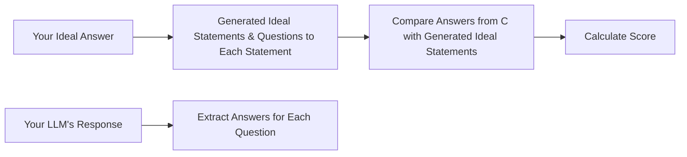

# Lamoom-CICD: Your AI Quality Assurance Engineer 🚀  
**Ensure Perfect LLM Responses - Before Your Users Notice Mistakes**

Tired of guessing if your AI's answers hit the mark? Lamoom-CICD acts as your 24/7 quality assurance team, automatically validating LLM responses against your standards. Get instant feedback and historical trends to continuously improve your prompts.

## Why Developers Love Us 💡

✔ **Precision Testing** - AI-generated evaluation questions catch nuances human reviewers might miss  
✔ **Historical Tracking** - Watch your prompt improvements materialize in real charts  
✔ **CI/CD Ready** - Batch test multiple scenarios in one CSV file  
✔ **Zero Configuration** - Get started with 3 lines of code  

## Get Started in 60 Seconds 🚦

```python
from lamoom_cicd import TestLLMResponsePipe

# 1. Define your gold standard and get LLM Response from your system
ideal_answer = "Blockchain: A shared digital ledger that's transparent and immutable"
get_llm_response = lambda: "Blockchain is like a public Google Doc that nobody can edit secretly"

# 2. Test your LLM's response
lamoom = TestLLMResponsePipe(openai_key="sk-your-key-here")
test_result = lamoom.compare(
    ideal_answer, 
    get_llm_response()
)

# 3. See instant quality report
print(f"Your AI scored {test_result.score}% ✅")
```

### Step 3: Understand Performance Trends
```python
lamoom.visualize_test_results()  # Launches interactive chart
```


## Enterprise-Grade Testing Made Simple 🏗

### Batch Test Multiple Scenarios
`tests.csv`
```csv
ideal_answer,llm_response,optional_params
"Blockchain is...", "Your LLM response", "{""prompt_id"": ""onboarding_flow""}"
"Smart contracts...", "LLM answer here", "{""prompt_id"": ""dev_docs""}"
```

```python
results = lamoom.compare_from_csv("tests.csv")  # Perfect for CI/CD pipelines
```

### Deep Dive into Results
```python
latest_test = results[-1]

print(f"Overall score: {latest_test.score}%")
for q in latest_test.questions:
    print(f"Q: {q.question}")
    print(f"Expected: {q.expected_answer}") 
    print(f"Got: {q.actual_answer}")
    print(f"Match: {'✅' if q.is_match else '❌'}")
```

## How We Ensure Accuracy 🔍

1. **Question Generation**  
   Our AI analyzes your ideal answer to create validation questions like:  
   _"What makes blockchain records tamper-resistant?"_

2. **Answer Extraction**  
   We scan both your ideal answer and LLM response for question answers

3. **Logical Validation**  
   Advanced comparison determines if answers match in meaning, not just wording



## Pro Tips for Maximum Impact 🚀

🔹 **Track Iterations**  
    Use `prompt_version` to compare different prompt versions over time  
    
🔹 **Context Matters**  
    Include user-specific data in optional_params for creating CI/CD pipeline at https://lamoom.com
    
🔹 **Threshold Alerts**  
    Flag any test scoring below 70% in your CI/CD pipeline  

```python
if test_result.score < 70:
    send_alert(f"Prompt {test_result.prompt_id} needs attention!")
```

## Join Our Quality Revolution ❤️

**Found a bug?**  
We'll fix it within 24 hours - [Open Issue](https://github.com/LamoomAI/lamoom-cicd/)

**Want to contribute?**  
We welcome PRs! Check our [Contribution Guide](CONTRIBUTING.md)

**Need enterprise support?**  
Email ask@lamoom.com for SLA guarantees and custom features

---

Made with ♥ by AI Quality Engineers at Lamoom. Let's build trustworthy AI together!
